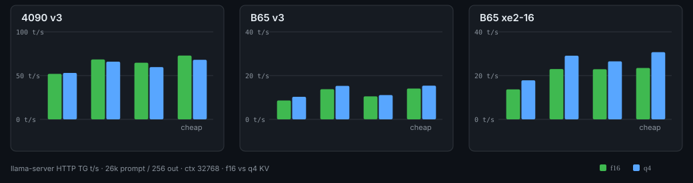

# llama.cpp-exl3xe2cuda

[Overview](#built-for) | [Qwen3.8 27B card](#card) | [Nemotron 3.5 Bolt](#nemotron-35-bolt) | [Run](#run)

Fork of [llama.cpp](https://github.com/ggml-org/llama.cpp) at `74a7c897f`.
EXL3 GGUFs on NVIDIA CUDA and Intel Xe2 SYCL. Normal Q/IQ GGUFs on the same
binaries. Xe2 dGPU (Arc Pro B65 class) gets extra decode speed on those
quants. MTP: `--spec-type draft-mtp`.

Not affiliated with ggml-org or Turboderp. Not an upstream PR.

## Built for

- EXL3 CUDA: NVIDIA sm_86 and sm_89 only. Proven on RTX 4090. A 3090-class
  card should load the same cubins; untested here. Older NVIDIA has no cubin.
  5090 (sm_120) is not in this fatbin.
- EXL3 SYCL: Intel Xe2 (`bmg_g21` / `bmg_g31`, Arc Pro B65). Lunar Lake can
  load EXL3. A770/PVC do not get EXL3 kernels. `GGML_SYCL_EXL3=0` forces off.
- Xe2 extras (IQ4/Q4 ESIMD, GDN COL2, fused RMS/gate): Battlemage dGPU only.
  Lunar Lake stays on stock SYCL. An A770 does not eat B65 defaults.
- B65 numbers are SYCL / Level Zero. ANV is the display Vulkan driver, not
  these rows. No Windows driver and no firmware flash are part of this card.
- AMD: stock ggml-vulkan in `build-vulkan` (R9700 / RADV). Q/IQ only. No EXL3.

## Three binaries

Same source. icpx cannot be the CUDA compiler. No EXL3 on Vulkan (yet).

```
# NVIDIA: EXL3 + Q/IQ
cmake -S . -B build-cuda -G Ninja -DGGML_CUDA=ON -DGGML_VULKAN=OFF \
  -DCMAKE_CUDA_ARCHITECTURES="86;89"
cmake --build build-cuda

# Intel Xe2 SYCL: EXL3 + Q/IQ (Xe2 extras on B65)
cmake -S . -B build-sycl -G Ninja -DGGML_SYCL=ON -DCMAKE_CXX_COMPILER=icpx
cmake --build build-sycl

# AMD (R9700 etc.): Q/IQ only, stock ggml-vulkan. No EXL3.
cmake -S . -B build-vulkan -G Ninja -DGGML_VULKAN=ON -DGGML_CUDA=OFF
cmake --build build-vulkan
```

## Convert ExLlamaV3 safetensors to GGUF

You need a packed EXL3 folder from ExLlamaV3 `convert.py` first (CUDA encode).
This repo does not run that Viterbi. Then, in this tree:

```
PYTHONPATH=./gguf-py python3 convert_hf_to_gguf.py <exl3-dir> --outtype auto
```

`--no-nextn` drops MTP. Vision: add `--mmproj --outtype f16`, then
`llama-quantize` the mmproj to Q8_0 if you want.

Quality pack is v3 MMA (`exl3.pack` v3). It loads on CUDA and Xe2 SYCL.

GGUFs (skip the convert if you just want to run):
https://huggingface.co/cesarsal1nas/Qwen3.8-27B-EXL3-GGUF
v3 is the quality default. xe2-16 is B65-only (CUDA aborts).

## Card

Different files and test settings, keep the rows separate. The card uses
llama-server HTTP, not llama-bench.

Stock Q/IQ is a normal GGUF. On a Battlemage dGPU this fork adds Xe2 extras
(IQ4/Q4 ESIMD GEMV, FA ESIMD, GDN COL2 when n_tokens>=16, fused GDN gate and
ADD+RMS, faster upload). Leave `GGML_SYCL_*` unset for these Qwen3.8 cells. That is not a new file,
and it does not make EXL3 v3 decode fast.

XE2MX4 is a separate quant. One block is 32 weights, 4-bit integer nibbles
(-8 to 7), and one fp16 scale. That is 4.5 bits per weight. Not MXFP4.
S48R is a fused rotation on that same block, not a wider group. Not EXL3.
CUDA does not load it. This tree includes the SYCL loader and quantizer.
The current card file is unrotated Orca Cyber XE2MX4, not S48R.

GGUF: https://huggingface.co/cesarsal1nas/Orca-Cyber-27B-XE2MX4-GGUF
File: `OrcaSAQ-2-27B-Uncensored-XE2MX4.gguf`.

EXL3 v3 is the quality pack. It loads on CUDA and Xe2 SYCL. Wiki PPL 6.42.
EXL3 xe2-16 is the same weights on a K-column walk. One trellis cannot feed
both walks. CUDA aborts xe2-16. Wiki PPL 6.62 vs v3 6.42. The ~30 t/s row is
xe2-16, not v3.

### 1. B65 only: stock IQ4 vs XE2MX4

Current unrotated release cell, 26k prompt, 256 output tokens, ctx 262144,
q4_0 target/draft KV, -b/-ub 3072, cheap MTP p-min 0, patched oneDNN:

```
file                         PP       TG      drafts     reading
Orca Cyber XE2MX4 unrotated   2034.1   38.23   102/153    8/8
```

Held-out wikitext-2 test, 100 chunks of 512 tokens, lower PPL is better:

```
Orca Cyber IQ4_XS source     6.8084
Orca Cyber XE2MX4 unrotated  6.9621
Orca Cyber XE2MX4 S48R       7.1969
```

S48R is what we used locally before this update, it was not a previous public
release. We switched to unrotated XE2MX4 because PPL was better at similar
speed, 6.96 vs 7.20, with the IQ4_XS source at 6.81.

This was requantized from IQ4_XS, not BF16, so there is another quantization
step. PPL is from the earlier runs on the same test text, not a fresh run on
this release binary, and it does not tell you how every task will go.

Historical S48R comparison follows. It is a different file and is not the
unrotated release card. The stock IQ4 rows are historical too.

Same source, Orca Cyber (Qwen3.8-27B class). B65 only. Not the 4090.
Not a matched argv. Stock side is the IQ4_XS GGUF with Xe2 extras, ctx 262144,
q4_0 KV, `-b 4096 -ub 4096`, draft-mtp n-max=2 p-min=0.55. XE2MX4 side is
`OrcaSAQ-2-27B-Uncensored-XE2MX4-S48R`, same ctx and q4 KV, ubatch 3072,
cheap MTP n-max=1.

```
stock IQ4   26k prompt 26176 @ 822 t/s,  generate ~42 t/s, draft ~155/170, peak 27.7 GiB
stock IQ4   62k prompt 61575 @ 696 t/s,  generate 36.7 t/s
XE2MX4      26k prompt        @ 2082-2106 t/s, generate 37-38 t/s, idle 23.8 / peak 27.6 GiB
XE2MX4      62k prompt        @ 1658 t/s, generate 25.0 t/s
```

Prefill is the win (about 2.5x at 26k). Generate is a bit slower. Idle VRAM
is lower because the packed copy is not sitting on the card the same way.
62k generate on XE2MX4 drops harder than the stock IQ4 row. Do not call that
a free lunch.

Other normal GGUF, same B65, extras left at default, ctx 32768, q4_0 KV,
draft-mtp n-max=1, 26k prompt. This is Xe2 extras, not an XE2MX4 file:

```
Qwopus IQ4_XS  prompt 26173 @ 535 t/s, 256 @ 28.6 t/s, draft 94/161
Qwopus Q4_K_M  prompt 26173 @ 566 t/s, 256 @ 34.8 t/s, draft 121/133
```

### Current unrotated long-context recall, B65

Release binary and unrotated Orca Cyber XE2MX4, ctx 262144, q4_0
target/draft KV, cheap MTP p-min 0, patched oneDNN, -b/-ub 3072.
Repeated technical document with one maintenance code planted at its middle.
The model answers the document topic and code; thinking disabled per request.

```
prompt tokens   PP tok/s   TG tok/s   output tokens   draft accepted/attempted
9198            2139.7     37.8       46              17/28
16959           2171.0     37.9       53              20/32
33726           1957.5     32.4       56              17/38
66513           1586.0     34.5       66              24/41
131137          1151.3     30.0       49              16/32
250736          760.7      27.8       65              24/40
```

The planted code was recovered at all six depths, including 250736 prompt
tokens. This is a single-needle recall smoke test, not the earlier five-fact
S48R test or a general long-document accuracy benchmark. TG is measured on
short answers, not the 256-token summary protocol.

### 2. Historical 4090 vs B65 XE2MX4-S48R

These are earlier S48R measurements, not a fresh unrotated comparison.
The 4090 was not re-tested for this README update.

Same Orca Cyber source. 4090 runs the stock IQ4_XS GGUF, CUDA, draft-mtp
n-max=3 p-min=0.55, `-b 4096 -ub 1024`. B65 runs the XE2MX4-S48R file, SYCL,
cheap MTP n-max=1, ubatch 3072. Those are the best flags for each card, not
one shared argv. ctx 262144, q4_0 KV, greedy, thinking off, generate until
the model stops. Depth is prompt tokens. Five planted facts, both cards 5/5
at every depth. No OOM.

```
depth    4090 PP  4090 TG   B65 PP   B65 TG
8192     2701     85.1      2301     40.2
16384    2606     78.8      2174     39.5
32768    2341     73.0      1944     39.7
65536    1868     57.2      1513     37.7
131072   1299     50.7      1119     34.7
250000   875      34.7      736      29.9
```

4090 MTP n=3 accepted 62-76% of drafts. B65 cheap n-max=1 accepted 63-67%.
VRAM stayed flat from 8k to 250k: 4090 idle 22.4 GiB, peak 23.0 / 24.6.
B65 idle 24.0 GiB, peak 27.7 / 32.

At 250k the B65 answered the five facts and stopped (51 tokens). The 4090
wrote the summary (630 tokens). Shorter depths, the B65 wrote the summary too.

### 3. Historical 4090 EXL3 vs B65 EXL3

Earlier EXL3 measurements retained separately from the XE2MX4 card.
These rows are historical, not fresh tests of this release.

File: `Qwen3.8-27B-EXL3-11.5GB-text-mtp-v3.gguf`, packed EXL3 from
GestaltLabs/Qwen3.8-27B-EXL3-11.5GB (Qwen3.8-27B, ~2.87 bpw, MTP).
In-tree GGUF convert only. Encode was ExLlamaV3 `convert.py` on the 4090.
Not a B65 encode.

PPL `llama-perplexity` wiki.test.raw 16x2048 on that v3 GGUF: 6.42 (CUDA).

llama-server HTTP, same LONG_PROMPT, ctx 32768, -b/-ub 2048, 256 out.
The picture is this block only.

```
4090 CUDA0 v3               prompt 26176 @ 1996 t/s, 256 @ 52.0 t/s
4090 CUDA0 v3 draft-mtp     prompt 26176 @ 1895 t/s, 256 @ 64.7 t/s (n-max=2 p-min=0.55, draft 155/176)
4090 CUDA0 v3 cheap p-min=0.35
                            prompt 26176 @ 1900 t/s, 256 @ 72.9 t/s (n-max=1, draft 118/135)
B65 SYCL0 v3 f16            prompt 26176 @ 876 t/s,  256 @ 8.65 t/s
B65 SYCL0 v3 q4 n-max=2     prompt 26176 @ 819 t/s,  256 @ 11.1 t/s (draft 153/175)
B65 SYCL0 xe2-16 f16        prompt 26176 @ 904 t/s,  256 @ 13.7 t/s (xe2-16 pack, CUDA aborts)
B65 SYCL0 xe2-16 q4 n-max=2 prompt 26176 @ 836 t/s,  256 @ 26.5 t/s (draft 153/172)
B65 SYCL0 xe2-16 q4 cheap p-min=0.35
                            prompt 26176 @ 836 t/s,  256 @ 30.7 t/s (draft 122/133; xe2-16 pack, CUDA aborts)
```

HTTP generate TG (f16 vs q4 KV). Same 26k/256 cell. B65 v3 is the quality pack on Intel, not the speed pack.



llama-cli greedy Test HTML (not HTTP), ctx 8192, EOS:

```
4090 CUDA0 v3            Prompt 774.2  Generation 57.5 t/s
4090 CUDA0 v3 n-max=2    Prompt 603.8  Generation 65.7 t/s
4090 CUDA0 v3 cheap 0.35 Prompt 549.1  Generation 77.6 t/s
B65 SYCL0 v3             Prompt 125.5  Generation 10.4 t/s
B65 SYCL0 xe2-16         Prompt 152.1  Generation 18.8 t/s  (xe2-16 pack, CUDA aborts)
B65 SYCL0 xe2-16 q4 cheap 0.35
                         Prompt 145.6  Generation 32.2 t/s  (xe2-16 pack, CUDA aborts)
```

Those rates are this model and this prompt. Another GGUF will differ.
llama-bench is synthetic; not the card.

ExLlamaV3 1.4.8, same 4090, GestaltLabs safetensors (not the GGUF):
tight-loop TG ctx0 62.1, PP512 1866, PP2048 2477.
LONG_PROMPT 256 out: plain TG 53.7 (llama.cpp no-MTP 52.0). ExL MTP n=1 TG 84.0
(llama.cpp --spec-mtp-cheap p-min 0.35 is 72.9). ExL MTP n=2 TG 39.0 (llama.cpp n-max=2 64.7).

### Current unrotated concurrency, B65

Release binary, patched oneDNN, fresh server per width, 16384 context tokens
per request, 2343-token repeated prompt, q4_0 target/draft KV, cheap MTP
p-min 0, -b/-ub 3072. Each request writes 4096 tokens with ignore_eos.
Thinking is disabled per request for this throughput cell.

```
requests  PP mean  TG/request median  total tok/s  accept  VRAM idle/peak GiB
1         1710.7   46.92              46.21        0.998   16.30/19.98
2         783.8    35.91              69.93        0.995   16.96/20.63
3         445.5    23.47              67.72        0.996   17.61/21.44
4         525.8    25.62              99.11        0.997   18.27/21.99
5         336.9    16.07              77.19        0.992   18.98/23.99
6         489.8    15.19              87.91        0.997   19.70/24.71
7         339.1    14.17              95.12        0.988   20.42/28.78
8         303.8    13.31              89.94        0.879   21.13/26.14
```

Total throughput includes prefill and request completion time. It peaks at
4 requests in this run; scaling is uneven and draft acceptance falls at 8.
All requests produced the full 4096 tokens, but this is a repeated-prompt
throughput test, not an agent-quality test or proof of clean slot reuse.
Historical S48R numbers below are a different file/runtime cell.

### 4. Historical concurrent: B65 S48R vs 4090

This table used S48R. It is not an unrotated release benchmark.

N chats at once, all sent together, counting everything they write. This is
the agent case, not one chat. Do not read it against block 2.

Same on both cards: each chat gets a 16384-token context (N chats means
N x 16384), q4_0 KV, a 2343-token prompt, 4096 tokens out, greedy, reasoning
off, MTP on, a fresh server for every row. The length is forced (`ignore_eos`)
so every chat writes the full 4096 and every row writes the same amount.

- B65: `OrcaSAQ-2-27B-Uncensored-XE2MX4-S48R`, SYCL, cheap MTP (n-max 1,
  p-min 0), ubatch 3072. The historical run explicitly set:
  `GGML_SYCL_XE2MX_GLU_TILE=92`, `GGML_SYCL_XE2MX_XMX_TILE=82`,
  `GGML_SYCL_XE2MX_MID16=1`. GLU 92 and XMX 82 are now Xe2 profile
  defaults; MID16 remains an explicit override.
- 4090: the IQ4_XS file that XE2MX4 was baked from, CUDA, draft-mtp n-max 3
  p-min 0.55, ubatch 1024. The 4090 cannot load XE2MX4.

Prefill is per chat: 2343 tokens over that chat's own prompt time. The chats
share the card, so once several are sent at once the number is far below the
single-chat one. Total decode is every
token written divided by the time from sending to the last chat finishing, so
prefill time is inside it. Per chat is the median chat's own decode rate.

prefill t/s per chat, mean (best chat)

```
chats   B65 XE2MX4        4090 IQ4_XS
1       1762              2732
2       902 (1122)        1483 (1613)
3       663 (1124)        1477 (1984)
4       737 (1115)        1136 (1503)
5       938 (1761)        1129 (1493)
6       544 (1127)        928 (1320)
7       625 (1148)        888 (1344)
8       597 (1147)        1055 (2280)
```

decode t/s, per chat (median) and all chats added together

```
chats   B65 per chat   B65 total   4090 per chat   4090 total   B65/4090
1       50.0           49.2        135.8           132.1        37%
2       35.7           69.8        110.0           210.8        33%
3       27.6           79.8        88.0            249.8        32%
4       25.9           99.3        76.0            284.4        35%
5       22.1           106.5       68.2            321.9        33%
6       20.6           116.4       59.2            320.4        36%
7       19.0           125.7       50.4            316.9        40%
8       17.1           131.1       48.8            363.6        36%
```

VRAM GiB, idle / peak

```
chats   B65          4090
1       16.3 / 20.0  15.5 / 15.5
2       17.0 / 20.7  16.4 / 16.5
3       17.6 / 21.4  17.4 / 17.5
4       18.3 / 22.1  18.4 / 18.5
5       19.0 / 22.8  19.4 / 19.5
6       19.7 / 23.5  20.4 / 20.5
7       20.4 / 24.3  21.4 / 21.5
8       21.1 / 25.1  22.4 / 22.5
```

The B65 total rises with every chat added, 49 to 131. The 4090 total goes
132, 211, 250, 284, 322, 320, 317, then 364 at 8, so it flattens between 5 and
7. The B65 per-chat rate falls from 50 to 17 t/s as chats are added, the 4090
from 136 to 49. The B65 total is 32-40% of the 4090 total at every width.

This prompt is one sentence repeated, so the model repeats it and both cards
accept 98-100% of draft tokens (block 2 on real text: 62-76%). The 4090 drafts
three tokens per step and the B65 one, so a prompt that is almost always
accepted favors the 4090. On real text (block 2) the B65 is about half of the
4090 per chat at 8k to 32k, not a third.

In this historical cell, B65 peak VRAM is about 4 GiB above idle while the
4090 barely moves. See Runtime memory.

Without `ignore_eos`, a chat sometimes ends on its own after a full copy of
the sentence (B65 on 3 of 8 widths, 4090 on 5 of 8; 22 to 4071 tokens). That
pulls the total down, which is why the rows above force the length.

### Runtime memory

The file is not the whole VRAM footprint, XE2MX4 stores 32 weights and an
FP16 scale per block (4.5 bpw), then runtime adds KV cache, recurrent state,
compute buffers and weight packs. It does not always use more VRAM than
another quant, compare the same model, context, slots and pack settings.

The model weights remain GPU-resident for decoding. With host-pack enabled,
an additional packed representation of attention/projection weights lives in
system RAM and is uploaded for prefill, then released from GPU residency for
decode. In the earlier Orca cell that pack was about 3.4 GiB. This saves resident
VRAM but uses host RAM and adds transfer overhead, especially on short prompts.
It is not CPU expert offload and does not mean the whole model runs from RAM.

Prefill needs temporary packs and working buffers, more slots add KV cache
and recurrent state, so peak minus idle is not just the host pack. Both
numbers are in the concurrent tables.

### Reading the card

Each table names the file and settings, loading a 262k context is not the
same as reading 250k correctly, and the older S48R rows are not results for
the unrotated file.

Fixed-length concurrency tests measure simultaneous inference, not autonomous
agent performance. The repeated prompt favors speculative decoding and does
not represent general coding/chat throughput. Total throughput includes
prefill and is not the same as one request's decode rate.

The fast XE2MX4 path requires patched oneDNN; stock oneDNN is a slower fallback.
The measured Intel card is Arc Pro B65. Other Xe2 dGPUs are architecture targets,
not benchmarked cards. CUDA and Vulkan do not run XE2MX4.

### Making an XE2MX4 file

The SYCL binary can quantize and load XE2MX4. Example for a BF16 source:

```
ONEAPI_DEVICE_SELECTOR=level_zero:1 ./build-sycl/bin/llama-quantize \
  --imatrix imatrix.gguf model-BF16.gguf model-XE2MX4.gguf XE2MX4
```

For a quantized source add `--allow-requantize`. That adds a second quantization
step. Output and token embeddings remain Q8_0. The command writes unrotated
XE2MX4; it does not bake S48R.

[Build, patched oneDNN, and run instructions](docs/xe2mx4.md).
The fast path needs patched oneDNN. Stock oneDNN uses a slower fallback.
Xe2 profile defaults apply automatically, explicit environment values override
them. `GGML_SYCL_XE2_PROFILE=0` disables the profile and
`GGML_SYCL_XE2_LOG=1` enables kernel diagnostics.

## Nemotron 3.5 Bolt

NVIDIA Nemotron 3.5 Bolt 74B-A9B (Mamba2 + attention + MoE) on Arc Pro B65, SYCL only,
experimental. One card runs a hybrid IQ2_XXS + XE2MX4 file, two cards run an XE2MX4 file
converted from BF16, with NVIDIA's LiLiCorr drafter optional. Launch with
`scripts/bolt-b65.sh`; needs oneAPI 2026.1 and the patched oneDNN.
GGUFs: https://huggingface.co/cesarsal1nas/Nemotron-3.5-Bolt-74B-A9B-XE2MX4-GGUF, or rebuild them
from NVIDIA's files with `scripts/bolt/`.

llama-server HTTP, reasoning on, q8_0 KV. Lab-build prompt ladder, warm retrieval request per
fresh server, not independent-run medians. Context allocation is not prompt length.

| Setup | Cards | ctx | Actual prompt tokens | PP t/s | TG t/s |
| --- | --- | --- | --- | --- | --- |
| Hybrid target | 1, internal | 262144 | 16116 | 2042 | 34.3 |
| Hybrid + LiLiCorr | 1, internal | 262144 | 16116 | 1489 | 52.2 |
| XE2MX4 target | 2 | 262144 | 16116 | 2442 | 39.8 |
| XE2MX4 + LiLiCorr | 2 | 262144 | 16116 | 2170 | 82.6 |

Separate 16384-context fast lab configuration with two B65s and LiLiCorr reached approximately
2457 PP / 85 TG. Do not mix that cell with the 262144-context ladder above. These are lab
measurements, not a rerun on the curated release binary.

Full 8k to 240k prompt ladders are on the linked HF card. Release-build smoke checks, sustained
lab numbers, models, checksums and limits: [docs/nemotron-bolt.md](docs/nemotron-bolt.md).

## MTP (two modes, same verify)

Both check drafts against the target. Cheap is not a skip-verify path.

Default, longer draft:

```
--spec-type draft-mtp --spec-draft-n-max 2 --spec-draft-p-min 0.55
```

4090 HTTP 256 @ 64.7 t/s (draft 155/176).

Cheap / ExL-style one extra MTP token (INT8 M=2, one launch, shared B):

```
--spec-type draft-mtp --spec-mtp-cheap --spec-draft-p-min 0.35
```

Forces n-max=1. Same greedy target check. 4090 HTTP 256 @ 72.9 t/s (draft 118/135), PP 1900.
MTP n_ubatch follows target (-ub 2048). Do not set n_ubatch=1. n-max=2 is unchanged (M=3 still one INT8 launch per row). ExL n=1 is 84 on the
same prompt (their q=2 kernel plus fused MTP). This flag does not skip verify.

## xe2-16 file

`convert_hf_to_gguf.py` only stamps `exl3.pack`. It does not walk K-columns.
To make xe2-16 safetensors from a v3 packed folder (CUDA + ExLlamaV3 installed):

```
python3 conversion/encode_exl3_xe2_from_what.py <v3-exl3-dir> <xe2-16-dir>
EXL3_PACK=xe2-16 PYTHONPATH=./gguf-py python3 convert_hf_to_gguf.py <xe2-16-dir> \
  --outtype auto
```

On GestaltLabs Qwen3.8-27B EXL3 that rematerialize was wiki PPL 6.62 vs v3 6.42.
Do not run ExLlama `convert.py` `EXL3_PACK=xe2-16` from dense BF16 expecting v3 PPL
(first-gen from BF16 was 8.71).

`llama-speculative-simple` Paris n=128 is not the HTTP cell above
(greedy 17.5, n-max=1 34.8, n-max=2 30.4). Do not quote that as llama-server.

## Run

Quality EXL3 GGUF, 4090:

```
./build-cuda/bin/llama-server --device CUDA0 -m model.gguf -ngl 99 \
  --flash-attn on --port 8080
```

Draft-mtp on the server:

```
./build-cuda/bin/llama-server --device CUDA0 -m model.gguf -ngl 99 \
  --flash-attn on --spec-type draft-mtp --spec-draft-n-max 2 \
  --spec-draft-p-min 0.55 --port 8080
```

B65 SYCL. If two Xe2 cards are present, pin the one that is not driving the monitor:

```
ONEAPI_DEVICE_SELECTOR=level_zero:1 ./build-sycl/bin/llama-server \
  --device SYCL0 -m model.gguf -ngl 99 --flash-attn on --port 8080
```

AMD R9700 Q/IQ (not EXL3). `--list-devices` and pick the RADV card:

```
./build-vulkan/bin/llama-server --device Vulkan0 -m q4.gguf -ngl 99 \
  --flash-attn on --port 8080
```

Q/IQ GGUFs load on all three binaries. EXL3 only on `build-cuda` and `build-sycl`.
Leave GGML_SYCL_* unset on B65 for Qwen3.8 and EXL3. Nemotron Bolt is the exception;
`scripts/bolt-b65.sh` sets its own flags, see [docs/nemotron-bolt.md](docs/nemotron-bolt.md).

## What we added

- EXL3 type, CUDA kernels (from ExLlamaV3), SYCL kernels, converter
- draft-mtp (n-max=1/2). n-max=3 is WIP, not in this tree
- Xe2 extras on normal Q/IQ, Battlemage dGPU only
- xe2-16 pack: see block 3 and the xe2-16 file section
- XE2MX4 quantizer, SYCL loader, Xe2 profile defaults and oneDNN patches

Not in this tree: EXL3 on Vulkan.

## License

- llama.cpp / ggml: MIT, The ggml authors. See `LICENSE`.
- EXL3 CUDA kernels in `ggml/src/ggml-cuda/exl3/`: derived from
  [ExLlamaV3](https://github.com/turboderp-org/exllamav3), MIT,
  Copyright 2025 Turboderp. See `licenses/LICENSE-exllamav3` and `NOTICE`.
- `exl3.cu` / `exl3.cuh` / `exl3_moe.cuh` are ggml glue / ours, not Turboderp.

Keep those notices if you copy this tree.

EXL3 is Turboderp's packed trellis format (QTIP-style). This repo does not
include QTIP paper code or ik_llama.cpp `IQ*_KT`.
